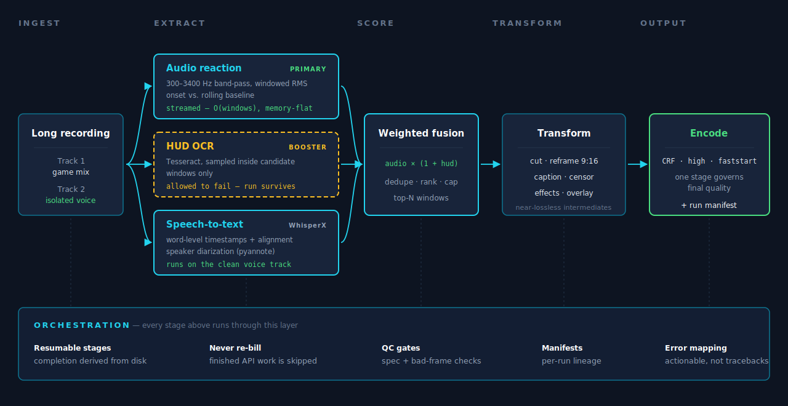

# shorts_pipeline

**An automated multimodal media processing pipeline.** Raw gameplay footage in, publish-ready video out — with highlight detection, speech-to-text, and quality-gated encoding running unattended.



Three signals are extracted independently from the same source, fused into a single score, and the top-ranked windows are cut and transformed. Every stage is resumable, every run emits a manifest.

---

## Why I built it

I produce short-form video content. The editing process was entirely manual and entirely repeatable: scrub an hour of footage looking for good moments, cut them, reframe to vertical, transcribe, caption, censor, encode, export. Several hours of work per finished clip, and the *same* work every time.

That is the classic case for a pipeline. The goal was to turn a repeatable manual process into an automated one — and specifically to make it **unattended, resumable, and cheap to re-run**, because the interesting failure mode isn't "it doesn't work," it's "it works but costs an hour and £3 in API calls every time you tweak a setting."

**Core goals:**

| Goal | Why it mattered |
|---|---|
| Find highlights automatically | Scrubbing footage manually was the biggest time sink |
| Survive long inputs | An hour of gameplay must not exhaust memory |
| Never redo finished work | Paid API calls (TTS, LLM) must not be re-billed on a re-run |
| Degrade, don't crash | A brittle optional signal must not kill a working run |
| One source of truth for quality | Repeated encoding was silently destroying output quality |

---

## Architecture

Three pipelines sharing one orchestration layer. Each solves a different problem; they share infrastructure but never reach into each other.

```
shorts_pipeline/
├── orchestrator/        shared: stage runners, state, manifests, QC, error mapping
│   ├── stages.py        idempotent stage wrappers (skip if output exists)
│   ├── state.py         per-run state DERIVED FROM DISK — resume, never re-bill
│   ├── manifest_gen.py  run provenance / lineage
│   ├── qc.py            quality gates: spec check, bad-frame detection
│   └── errors.py        production failure modes → actionable messages
│
├── fullauto/            automated highlight detection (long video → ranked clips)
│   ├── reaction.py      PRIMARY signal: streaming audio-energy analysis
│   ├── hud.py           SECONDARY signal: HUD OCR, allowed to fail
│   ├── highlight.py     four-signal fusion + weighted ranking
│   ├── candidates.py    top-N export, preserves both audio tracks
│   └── clips.py         detect → rank → export → manifest
│
├── gameplay/            the transform pipeline (clip → finished output)
│   ├── transcribe.py    WhisperX ASR + word alignment + speaker diarization
│   ├── device.py        single source of truth for CUDA vs CPU + model size
│   ├── transcript.py    the data model — (text, start, end, speaker)
│   ├── editing.py       pure grid operations (bulk edit, merge, split)
│   ├── censor.py        one word-list driving both audio bleep and caption mask
│   ├── reframe.py       16:9 → 9:16, four layout strategies
│   ├── effects.py       audio-energy-driven effects as ffmpeg filters
│   └── encode.py        SINGLE SOURCE OF TRUTH for output quality
│
└── modules/             the narrated-video pipeline (script → TTS → visuals → assemble)
    ├── script.py        LLM rewrite
    ├── tts.py           ElevenLabs voiceover — deliberately no fallback
    ├── captions.py      Whisper word-level timestamps → styled subtitles
    └── audio_mix.py     multi-layer mixer: pure placement logic + ffmpeg render
```

---

## Tech stack, and why

| Choice | Reasoning |
|---|---|
| **Python** | The whole ecosystem I needed — audio (numpy), ASR (WhisperX), OCR (Tesseract), orchestration — lives here |
| **ffmpeg** | Every video operation is expressed as an ffmpeg filter graph rather than per-frame Python compositing. Orders of magnitude faster, and it's the tool the industry actually uses |
| **numpy** | Windowed RMS over streamed PCM. Already a core dependency, no extra weight |
| **WhisperX** + pyannote | Word-level timestamps, not just sentence-level — the caption renderer needs per-word timing. Diarization separates 4–5 speakers |
| **Tesseract OCR** | Free, local, no API cost for a signal that's only a scoring booster |
| **ElevenLabs** | Quality matters for narration; a local TTS was audibly worse |
| **Gradio** | The interface is a means to an end. Gradio gave me a working UI in hours instead of days, and streaming generators map cleanly onto pipeline progress events |
| **JSON manifests on disk** | No database needed — state is derived from the filesystem, which makes runs trivially inspectable and resumable |

**On the decision not to use a database:** every stage's completion is derived from whether its output file exists. That sounds primitive, but it means there's no state to get out of sync with reality, and recovery after a crash is automatic. For a single-machine batch pipeline it was the right trade — if this ran as a service across multiple workers, that decision would flip immediately.

---

## The problems worth talking about

### 1. Analysing hours of audio without exhausting memory

**Problem.** Highlight detection needs to analyse the full audio track of a recording that might run an hour or more. Decoding that to a numpy array is gigabytes of PCM in memory.

**Solution.** `reaction.py` streams the audio block-by-block through a vocal band-pass (~300–3400 Hz, so game explosions and music count for less than a human exclamation) and folds each block immediately into a small per-window RMS array. The full signal is never resident — the analysis is **O(windows)**, not O(samples), and memory stays flat regardless of input length.

Detection then scores each window by *suddenness* against a rolling baseline, with the onset term dominating sustained energy — a sharp "WHAT?!" outscores a long noisy teamfight.

> This is the piece I'd point at first. It's the difference between something that works on a test clip and something that works on real data.

### 2. Never re-billing work that's already done

**Problem.** Some stages cost real money (LLM calls, ElevenLabs TTS) or real time (GPU transcription). Early on, changing one caption setting meant re-running everything — re-billing the API calls for outputs that hadn't changed.

**Solution.** Stage completion is **derived from disk** (`orchestrator/state.py`, `gameplay/state.py`). Each stage writes to a predictable path; if that path exists, the stage is skipped unless explicitly forced. A re-run fills gaps rather than redoing work, and a crash mid-run resumes where it stopped.

Stages are also split by *what they depend on*: the reframe depends only on the source, so it's cached across rebuilds, while caption/effect stages rebuild when their toggles change. TTS is cached by `(text, voice)` so identical narration is never re-synthesised.

### 3. Combining unreliable signals without becoming unreliable

**Problem.** I had two ways to find highlights. Audio reaction is robust but imprecise. HUD OCR (reading kill banners off the game UI) is precise but brittle — it breaks on different resolutions, and depends on an external OCR binary that may not be installed.

**Solution.** Make them asymmetric rather than equal. Audio is the **primary trigger**; HUD OCR is a **booster that is allowed to fail**:

```
final_score = audio_score × (1 + hud_boost)
```

The entire OCR scan is wrapped so any failure — no OCR backend, an ffmpeg hiccup, an unexpected screen layout — yields zero events and the audio candidate survives untouched. There's a master switch to disable it entirely. It also only samples frames *inside* an already-identified candidate window, so it's cheap.

The larger version of this (`highlight.py`) fuses four signals — energy peaks, keyword scan, transcript-boundary framing, and an LLM judge returning strict JSON over overlapping transcript chunks — into a weighted sum, then dedupes and caps.

### 4. Knowing when NOT to degrade gracefully

Worth contrasting with the above: `tts.py` has **deliberately no fallback**. If the ElevenLabs key is missing or the call fails, the pipeline raises and stops.

That's the opposite decision to the OCR one, and it's intentional. A missing scoring booster costs you a slightly worse ranking. A silently substituted robot voice ships a bad video under your name. **Degrade where the output is still acceptable; fail loudly where it isn't.**

### 5. Compounding quality loss across a multi-stage transform

**Problem.** Output looked soft on mobile and I couldn't work out why. The cause: each stage (reframe → effects → captions → overlay) was independently re-encoding at CRF 20. Four sequential lossy encodes compounded to roughly half the bitrate the output actually needed.

**Solution.** `encode.py` became the single source of truth. Intermediates are now near-lossless; only the **final** encode is quality-targeted (CRF, high profile, faststart for mobile streaming). One stage governs quality instead of four fighting each other.

> A generational-loss bug across pipeline stages is a data engineering problem wearing a video costume: each hop was lossy, and nobody owned the end-to-end quality budget.

### 6. Fixing data quality at the source, not downstream

**Problem.** Speech-to-text accuracy was poor because game audio was drowning the voice in the recorded mix.

**Solution.** Rather than fighting it with filters after the fact, I reconfigured OBS to record **dual audio tracks** — Track 1 the full mix, Track 2 an isolated voice channel. ASR now runs on clean input. The candidate exporter explicitly preserves *both* tracks through the cut so downstream transcription still has the clean channel.

> The cheapest place to fix a data quality problem is upstream of the pipeline, not inside it.

### 7. Keeping the logic testable

A pattern repeated deliberately throughout: **pure transformation logic is separated from I/O**, so the interesting parts unit-test without a GPU, an API key, or ffmpeg installed.

- `audio_mix.resolve_placements()` is pure and fully unit-testable; `render_mix()` does the ffmpeg work
- `censor.py` — matching, span merging, filter-string generation — imports no ffmpeg and no UI framework
- `editing.py` — bulk edits, merges, splits — imports no Gradio
- `transcript.py` stays free of the heavy WhisperX/torch import
- torch is imported lazily and defensively, so the package imports fine on a machine without it

The `(text, start, end, speaker)` tuple is a **stable data contract** across the transcript model, the editor, the caption transform, and the renderer. The editor was rewritten completely — from a mouse-bound grid to a keyboard-driven one — without changing that contract, so nothing downstream needed touching.

---

## What it produces

- **Automated highlight detection** over long recordings, exporting ranked candidates with a score and a machine-readable reason for each selection
- **Finished vertical output** — reframed, word-level captioned, profanity-censored (audio bleep and caption mask driven by one word-list so they always agree), optional energy-driven effects, overlay, mobile-optimised encode
- **A landscape long-form path** and a **music-montage builder**, both reusing the same reframe/overlay/encode components
- **Per-run manifests** recording what was produced and why
- A **Gradio interface** over all of it, with progress streaming from worker threads so the UI never blocks

The system has been used in production to publish real content, which is where most of these problems were found.

---

## Why this is commercially relevant

The domain is video. The engineering is not.

| What this project does | The general problem it's an instance of |
|---|---|
| Streams audio block-by-block | Processing datasets larger than memory |
| Stage completion derived from disk | Idempotent, resumable pipelines |
| Skips already-complete stages | Cost control on metered API calls |
| Audio primary, OCR optional booster | Graceful degradation of unreliable data sources |
| ElevenLabs fails loudly | Knowing which failures must *not* be swallowed |
| One encode governs quality | Owning end-to-end quality across multi-hop transforms |
| Dual-track recording | Fixing data quality upstream rather than downstream |
| Pure logic split from I/O | Testable pipeline code |
| Stable tuple contract | Schema stability between pipeline stages |
| Manifests per run | Lineage and provenance |

Every one of those transfers directly to a data platform where the payload is rows rather than frames. Ingestion, feature extraction, scoring, transformation, quality gates, and resumability are the same concerns whatever the data is — multimodal media is simply a harder input format than CSV.

---

## What I'd do differently

**Integration tests, not just unit tests.** The pure-logic separation means the components are well covered individually. But the encode-quality bug lived in the *interaction* between four stages that each worked correctly on their own. Unit tests could never have caught it. That's the gap I'd close first — and it's a lesson I hit again on a recent team project, where a full unit suite passed while data was being silently dropped between two modules.

**Structured logging and run metrics.** Right now, diagnosing a slow or poor run means reading through progress output. Emitting structured per-stage timings and counts would make the pipeline observable rather than merely inspectable.

**Configuration as data.** Tunables are spread across two `config.py` files and environment variables. A single validated config schema would make runs more reproducible and settings easier to sweep.

**Split the monolithic UI.** `app.py` grew organically into something far too large. The pipeline modules stayed clean because they had clear boundaries; the UI didn't, because it never had one imposed.

**Reconsider the storage decision at scale.** Filesystem-derived state is elegant for one machine. The moment this needed to run across multiple workers, it would need a real state store — that decision was correct for the constraints, and would be wrong under different ones.

---

## Running it

```bash
python -m venv .venv && .venv\Scripts\activate
pip install -r requirements.txt
pip install -r requirements-gameplay.txt      # GPU/ASR extras

cp .env.example .env                           # add API keys — .env is gitignored
python app.py                                  # launches the interface
```

Requires **ffmpeg** on PATH. GPU strongly recommended for transcription; the pipeline detects a CPU-only torch build, selects an appropriate model size, and warns rather than failing.

```bash
pytest -v                                      # pure-logic tests, no GPU or API keys needed
```

---

*Built and iterated over several months as a working production tool. Every design decision documented above came from a problem that actually occurred.*
