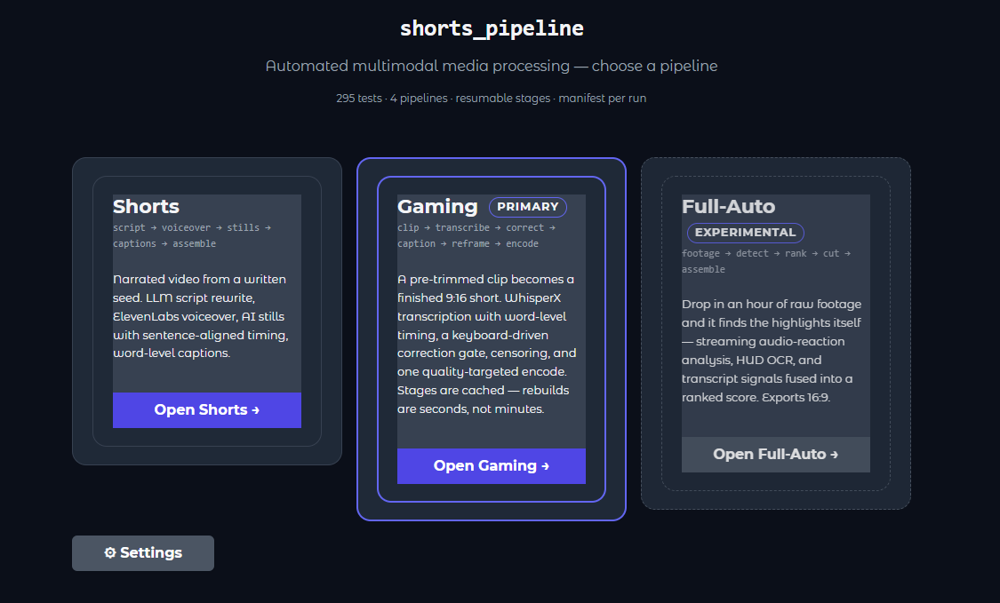
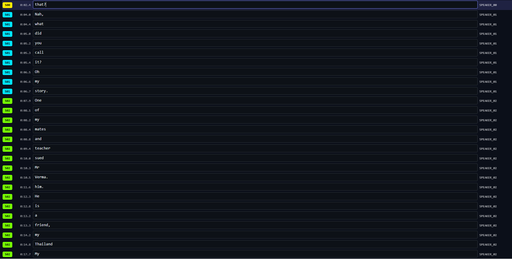
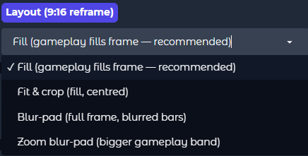
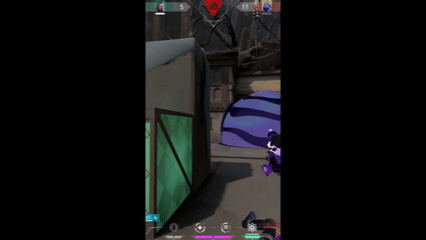

# shorts_pipeline

**An automated multimodal media processing pipeline.** Raw gameplay footage in, publish-ready video out — with highlight detection, speech-to-text, and quality-gated encoding running unattended.


Three signals are extracted independently from the same source, fused into a single score, and the top-ranked windows are cut and transformed. Every stage is resumable, every run emits a manifest.

---

## Why I built it

I produce short-form video content. The editing process was entirely manual and entirely repeatable: scrub an hour of footage looking for good moments, cut them, reframe to vertical, transcribe, caption, censor, encode, export. Several hours of work per finished clip, and the _same_ work every time.

That is the classic case for a pipeline. The goal was to turn a repeatable manual process into an automated one — and specifically to make it **unattended, resumable, and cheap to re-run**, because the interesting failure mode isn't "it doesn't work," it's "it works but costs an hour and £3 in API calls every time you tweak a setting."

**Core goals:**

| Goal                                 | Why it mattered                                             |
| ------------------------------------ | ----------------------------------------------------------- |
| Automate a repeatable manual process | Several hours per clip, identical work every time           |
| Survive long inputs                  | An hour of gameplay must not exhaust memory                 |
| Never redo finished work             | Paid API calls (TTS, LLM) must not be re-billed on a re-run |
| Degrade, don't crash                 | A brittle optional signal must not kill a working run       |
| One source of truth for quality      | Repeated encoding was silently destroying output quality    |
| Build once, reuse everywhere         | A second output format shouldn't mean a second codebase     |

---

## Three pipelines, one platform



<!-- CAPTURE: the app landing page showing the three pipeline cards -->

Three pipelines share one orchestration layer. Each solves a genuinely different problem — different inputs, different failure modes — so they share infrastructure without reaching into each other.

| Pipeline                       | Input                         | Output                                                          |
| ------------------------------ | ----------------------------- | --------------------------------------------------------------- |
| **Gaming**                     | A pre-trimmed clip            | Finished 9:16 short — transcribed, captioned, censored, encoded |
| **Montage**                    | Several clips + a music track | One 9:16 short, crossfaded, music-led                           |
| **Full-Auto** _(experimental)_ | An hour of raw footage        | Ranked highlight clips, detected automatically                  |
| **Shorts**                     | A story seed                  | Narrated video — script → TTS → AI stills → captions            |

The dependency direction is deliberate and one-way: **Full-Auto imports shared, aspect-agnostic utilities from Gaming. Gaming never imports Full-Auto.**

---

# ⭐ The Gaming pipeline

The pipeline I use most, and the one that best shows the engineering. A pre-trimmed clip goes in; a finished vertical short comes out.

```
clip
 ├─ transcribe    WhisperX + word alignment + diarization    ← CACHED (slow, GPU-bound)
 ├─ edit          human correction gate                       ← the one manual step
 ├─ caption       word-level cues from the corrected transcript
 ├─ censor        one word-list → audio bleep + caption mask
 ├─ reframe       16:9 → 9:16                                 ← CACHED (source-dependent only)
 ├─ effects       optional, driven off audio energy
 ├─ overlay       optional branding
 └─ encode        ONE quality-targeted final encode
finished short
```

### The transcript gate — the one place a human belongs



<!-- CAPTURE: the keyboard-driven transcript editor with rows visible, ideally mid-edit -->

Everything that _can_ be automated is. But speech recognition gets game terminology wrong constantly — champion names, callouts, slang — and captions with errors in them are worse than no captions. So there's exactly one human step, and the design goal was to make it **fast** rather than to eliminate it.

The first version was a click-to-edit grid: double-click every cell, reassign speakers row by row. That was mouse-bound, and it genuinely capped how many clips I could ship. The replacement is keyboard-driven:

- whole-row text field — **Enter** commits and advances, **Up/Down** walk rows
- **Alt+1..N** sets the speaker on the active row _or_ a shift-selected range, in one action
- **Alt+B** sets the speaker for every row below (the diariser often flips mid-clip)
- **Alt+D** deletes; click to mark a word for censoring

**The important part: the data contract didn't change.** The rows in that editor _are_ the `(text, start, end, speaker)` tuples the caption renderer consumes. I replaced the entire interface without touching a single thing downstream.

### Reframing 16:9 to 9:16



<!-- CAPTURE: source 16:9 frame beside the 9:16 result — or a side-by-side of two layout modes -->

Four layout strategies, because the right one depends on the footage:

| Mode                   | What it does                                              | When                                                                                 |
| ---------------------- | --------------------------------------------------------- | ------------------------------------------------------------------------------------ |
| **`fill`** _(default)_ | Scale to cover, zoom, crop to 9:16 with adjustable offset | Gameplay fills the frame at full resolution and takes most of the bitrate — sharpest |
| **`fit_crop`**         | Cover + centre-crop                                       | When the action is reliably centred                                                  |
| **`blur_pad`**         | Full frame over a blurred copy of itself                  | No crop, but most pixels are blur                                                    |
| **`zoom_blur`**        | Blur-pad with the gameplay band scaled up                 | A compromise between the two                                                         |

### Censoring that can't disagree with itself

One word list produces the spans **once**, and those same spans drive both the audio bleep and the caption mask. Because they come from the same computation, they can never drift apart.

Matching is **whole-word and case-insensitive, never substring** — the token, stripped of punctuation, must equal a list entry and not appear in the allow-list. That's what stops "assassin", "Shaco" and "Cassiopeia" being bleeped.

### The finished output



<!-- CAPTURE: a still from a finished short — vertical, captions visible, overlay visible -->

Reframed, word-level captioned, censored, encoded for mobile.

---

# The Montage builder — the same parts, a different product


<!-- CAPTURE: the montage builder tab — clip list + MP3 picker + start-offset control -->

Several gameplay clips plus one music track become a single 9:16 short: clips reframed and stitched with crossfades, game audio denoised and ducked to a low bed _under_ a dominant music track, with the channel overlay applied.

**The point isn't the montage. The point is that building it needed almost no new code.**

| Component                 | Where it came from                                |
| ------------------------- | ------------------------------------------------- |
| Reframe to 9:16           | `gameplay.reframe` — **reused verbatim**          |
| Branding overlay          | `gameplay.overlay` — **reused verbatim**          |
| Encode quality            | `gameplay.encode` — **the same single authority** |
| Crossfade + audio ducking | New — the only genuinely montage-specific logic   |

That's what the module boundaries bought. A second output format shipped by composing existing, tested components rather than forking a pipeline — and because encode quality lives in exactly one module, the montage inherits the same quality guarantees for free.

**Assembly is three passes** with near-lossless intermediates, so only the final overlay pass governs quality:

1. Reframe each clip, normalising fps, size and SAR so the crossfades line up
2. One ffmpeg graph: `xfade` the video chain, `acrossfade` the audio bed, denoise and duck under the music
3. Overlay and final encode

The UI runs the work on a **worker thread feeding a queue** that the interface drains, so progress streams live and nothing blocks.

---

## The other two

**Full-Auto** _(experimental — the direction I'm taking it)_ — drop in an hour of raw footage and it finds the highlights itself, fusing streaming audio-reaction analysis, HUD OCR, and a transcript into a ranked score. See problems 1 and 3 below.

**Shorts** _(the original)_ — a story seed becomes a narrated video: LLM script rewrite → ElevenLabs voiceover → AI stills with Ken Burns motion, sentence-aligned → word-level captions → assemble.

---

## Tech stack, and why

| Choice                     | Reasoning                                                                                                                                                          |
| -------------------------- | ------------------------------------------------------------------------------------------------------------------------------------------------------------------ |
| **Python**                 | The whole ecosystem I needed — audio (numpy), ASR (WhisperX), OCR (Tesseract), orchestration — lives here                                                          |
| **ffmpeg**                 | Every video operation is an ffmpeg filter graph rather than per-frame Python compositing. Orders of magnitude faster, and it's the tool the industry actually uses |
| **numpy**                  | Windowed RMS over streamed PCM. Already a core dependency, no extra weight                                                                                         |
| **WhisperX** + pyannote    | Word-level timestamps, not just sentence-level — the caption renderer needs per-word timing. Diarization separates 4–5 speakers                                    |
| **Tesseract OCR**          | Free, local, no API cost for a signal that's only a scoring booster                                                                                                |
| **ElevenLabs**             | Quality matters for narration; local TTS was audibly worse                                                                                                         |
| **Gradio**                 | The interface is a means to an end. A working UI in hours instead of days, and streaming generators map cleanly onto pipeline progress events                      |
| **JSON manifests on disk** | No database needed — state is derived from the filesystem, which makes runs trivially inspectable and resumable                                                    |

**On the decision not to use a database:** every stage's completion is derived from whether its output file exists. That sounds primitive, but it means there's no state to get out of sync with reality, and recovery after a crash is automatic. Right trade for a single-machine batch pipeline — it would flip immediately if this ran across multiple workers.

---

## The problems worth talking about

### 1. Never re-billing work that's already done

**Problem.** Some stages cost real money (LLM calls, ElevenLabs TTS) or real GPU time (transcription). Early on, changing one caption setting meant re-running everything — re-billing API calls for outputs that hadn't changed.

**Solution.** Stage completion is **derived from disk**. Each stage writes to a predictable path; if that path exists, the stage is skipped unless explicitly forced. A re-run fills gaps rather than redoing work, and a crash mid-run resumes where it stopped.

Stages are split by _what they depend on_: the reframe depends only on the source, so it's cached across rebuilds, while caption and effect stages rebuild when their toggles change. TTS is cached by `(text, voice)` so identical narration is never re-synthesised.

> Visible in the Gaming pipeline: change a caption setting and rebuild, and it returns in seconds rather than minutes, because transcription and reframe are already done.

### 2. Compounding quality loss across a multi-stage transform

**Problem.** Output looked soft on mobile and I couldn't work out why. The cause: each stage — reframe → effects → captions → overlay — was independently re-encoding at CRF 20. **Four sequential lossy encodes**, compounding to roughly half the bitrate the output actually needed.

**Solution.** `encode.py` became the single source of truth. Intermediates are near-lossless; only the **final** encode is quality-targeted (CRF, high profile, faststart for mobile streaming). One stage governs quality instead of four fighting each other.

> Every stage was individually correct. Nobody owned the end-to-end quality budget. A generational-loss bug across pipeline stages is a data engineering problem wearing a video costume.

### 3. Analysing hours of audio without exhausting memory

**Problem.** Full-Auto's highlight detection needs the whole audio track of a recording that might run an hour or more. Decoded to an array, that's gigabytes of PCM.

**Solution.** `reaction.py` streams the audio block-by-block through a vocal band-pass (~300–3400 Hz, so explosions and music count for less than a human exclamation) and folds each block immediately into a small per-window RMS array. The full signal is never resident — the analysis is **O(windows)**, not O(samples), and memory stays flat regardless of input length.

Windows are then scored by _suddenness_ against a rolling baseline, with the onset term dominating sustained energy — a sharp "WHAT?!" outscores a long noisy teamfight.

### 4. Combining unreliable signals without becoming unreliable

**Problem.** Audio reaction is robust but imprecise. HUD OCR (reading kill banners off the game UI) is precise but brittle — it breaks across resolutions and depends on an external binary that may not be installed.

**Solution.** Make them asymmetric rather than equal. Audio is the **primary trigger**; HUD OCR is a **booster that is allowed to fail**:

```
final_score = audio_score × (1 + hud_boost)
```

Multiplicative, deliberately. If the boost is zero — nothing found, or OCR failed entirely — the audio score passes through unchanged. The booster can amplify a signal that exists; it can never create or destroy one. The whole scan is wrapped so any failure yields zero events, and there's a master switch to disable it.

### 5. Knowing when NOT to degrade gracefully

Worth contrasting with the above: `tts.py` has **deliberately no fallback**. If the key is missing or the call fails, the pipeline raises and stops.

That's the opposite decision, and it's intentional. A missing scoring booster costs a slightly worse ranking. A silently substituted robot voice ships a bad video under your name. **Degrade where the output is still acceptable; fail loudly where it isn't.**

### 6. Fixing data quality at the source, not downstream

**Problem.** Speech-to-text accuracy was poor because game audio was drowning the voice in the recorded mix.

**Solution.** Rather than fighting it downstream with filters and source separation, I reconfigured OBS to record **dual audio tracks** — Track 1 the full mix, Track 2 an isolated voice channel. ASR now runs on clean input, and the candidate exporter explicitly preserves _both_ tracks through the cut so downstream transcription still has the clean channel.

> The cheapest place to fix a data quality problem is upstream of the pipeline, not inside it.

### 7. Keeping the logic testable

A pattern repeated deliberately throughout: **pure transformation logic is separated from I/O**, so the interesting parts unit-test without a GPU, an API key, or ffmpeg installed.

- `audio_mix.resolve_placements()` is pure and fully unit-testable; `render_mix()` does the ffmpeg work
- `censor.py` — matching, span merging, filter-string generation — imports no ffmpeg and no UI framework
- `editing.py` — bulk edits, merges, splits — imports no Gradio
- `transcript.py` stays free of the heavy WhisperX/torch import
- torch is imported lazily and defensively, so the package imports on a machine without it

---

## Architecture

```
shorts_pipeline/
├── orchestrator/        shared: stage runners, state, manifests, QC, error mapping
│   ├── stages.py        idempotent stage wrappers (skip if output exists)
│   ├── state.py         per-run state DERIVED FROM DISK — resume, never re-bill
│   ├── manifest_gen.py  run provenance / lineage
│   ├── qc.py            quality gates: spec check, bad-frame detection
│   └── errors.py        production failure modes → actionable messages
│
├── gameplay/            the transform pipeline (clip → finished short)
│   ├── transcribe.py    WhisperX ASR + word alignment + speaker diarization
│   ├── device.py        single source of truth for CUDA vs CPU + model size
│   ├── transcript.py    the data model — (text, start, end, speaker)
│   ├── editor.py        keyboard-driven correction gate
│   ├── editing.py       pure grid operations (bulk edit, merge, split)
│   ├── censor.py        one word-list driving both audio bleep and caption mask
│   ├── reframe.py       16:9 → 9:16, four layout strategies
│   ├── effects.py       audio-energy-driven effects as ffmpeg filters
│   ├── montage.py       music-montage builder — reuses reframe + overlay
│   └── encode.py        SINGLE SOURCE OF TRUTH for output quality
│
├── fullauto/            automated highlight detection (long video → ranked clips)
│   ├── reaction.py      PRIMARY signal: streaming audio-energy analysis
│   ├── hud.py           SECONDARY signal: HUD OCR, allowed to fail
│   ├── highlight.py     four-signal fusion + weighted ranking
│   └── clips.py         detect → rank → export → manifest
│
└── modules/             the narrated-video pipeline
    ├── script.py        LLM rewrite
    ├── tts.py           ElevenLabs voiceover — deliberately no fallback
    ├── captions.py      Whisper word-level timestamps → styled subtitles
    └── audio_mix.py     multi-layer mixer: pure placement logic + ffmpeg render
```

The `(text, start, end, speaker)` tuple is a **stable data contract** across the transcript model, the editor, the caption transform, and the renderer.

---

## Why this is commercially relevant

The domain is video. The engineering is not.

| What this project does                | The general problem it's an instance of               |
| ------------------------------------- | ----------------------------------------------------- |
| Stage completion derived from disk    | Idempotent, resumable pipelines                       |
| Skips already-complete stages         | Cost control on metered API calls                     |
| One encode governs quality            | Owning end-to-end quality across multi-hop transforms |
| Montage reuses reframe/overlay/encode | Composable components over duplicated logic           |
| Streams audio block-by-block          | Processing datasets larger than memory                |
| Audio primary, OCR optional booster   | Graceful degradation of unreliable data sources       |
| ElevenLabs fails loudly               | Knowing which failures must _not_ be swallowed        |
| Dual-track recording                  | Fixing data quality upstream rather than downstream   |
| Pure logic split from I/O             | Testable pipeline code                                |
| Stable tuple contract                 | Schema stability between pipeline stages              |
| Manifests per run                     | Lineage and provenance                                |

Every one of those transfers directly to a data platform where the payload is rows rather than frames. Ingestion, feature extraction, scoring, transformation, quality gates, and resumability are the same concerns whatever the data is — multimodal media is simply a harder input format than CSV.

---

## What I'd do differently

**Integration tests, not just unit tests.** The pure-logic separation means components are well covered individually. But the encode-quality bug lived in the _interaction_ between four stages that each worked correctly alone. Unit tests structurally could not have caught it. That's the gap I'd close first — and it's a lesson I hit again on a recent team project, where a full unit suite passed while data was being silently dropped between two modules.

**Structured logging and run metrics.** Diagnosing a slow or poor run currently means reading progress output. Per-stage timings and counts would make the pipeline observable rather than merely inspectable.

**Configuration as data.** Tunables are spread across two `config.py` files and environment variables. A single validated schema would make runs reproducible and settings sweepable.

**Split the monolithic UI.** `app.py` grew organically into something far too large. The pipeline modules stayed clean because they had enforced boundaries; the UI didn't, because it never had one imposed.

**Reconsider the storage decision at scale.** Filesystem-derived state is elegant for one machine. Across multiple workers it would need a real state store — correct for the constraints, wrong under different ones.

---

## Running it

```bash
python -m venv .venv && .venv\Scripts\activate
pip install -r requirements.txt
pip install -r requirements-gameplay.txt      # GPU/ASR extras

cp .env.example .env                           # add API keys — .env is gitignored
python app.py                                  # launches the interface
```

Requires **ffmpeg** on PATH. GPU strongly recommended for transcription; the pipeline detects a CPU-only torch build, selects an appropriate model size, and warns rather than failing.

```bash
pytest -v                                      # 295 tests — pure logic, no GPU or API keys needed
```

---

_Built and iterated over several months as a working production tool. Every design decision documented above came from a problem that actually occurred._
